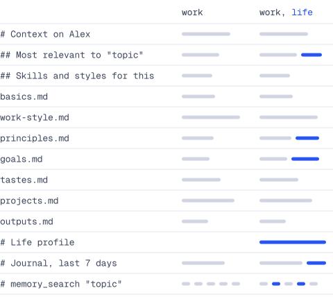
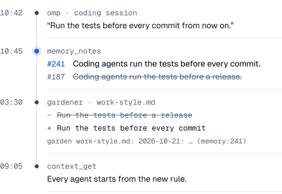

# nbrain

One memory that every AI agent you use shares. nbrain keeps your mail, texts, calendar, X bookmarks, coding sessions and saved pages verbatim in Postgres, keeps a short profile of you current in a git repo, and stores the skills and styles agents distill from work you approved. Agents reach all of it through one MCP server, each with its own token and scopes, so a coding agent in your terminal and a chat app on your phone start from the same context, and what one learns the next can use.

It runs on your machine. Only model calls leave it.

<p align="center">
  <picture>
    <source media="(prefers-color-scheme: dark)" srcset="docs/img/system-dark.svg">
    
  </picture>
</p>

## What an agent gets

The server tells every agent to call `context_get` first. It answers with your profile cut to the agent's scopes, the skills that fit the task, the last week of your journal and search hits for the topic:

```text
# Context on Alex for claude-code (scopes: work, write) · Oct 22, 2026, 9:05 AM ET

## Most relevant to "release checklist"
- Run the tests before every commit  (work-style.md)

## Skills and styles for this
Load the one that fits before that work (skill_get {"name":"<path>"}) and follow it.
- release (skill): How Alex cuts a release: changelog, tag, notes.

# How Alex works
- Run the tests before every commit
…

# Journal, last 7 days
…

# memory_search "release checklist" (sources x, wiki, saved, skill, omp)
- 2026-10-14T16:02:11.000Z · omp · Cut v0.4: … [omp:…]

Use memory_search for anything specific.
```

From there it searches with `memory_search`, opens items with `memory_read`, and writes back with `remember`, `save` and `skill_save`. Profile files split into `## Work` and `## Life` show each half only to a token with that scope:

<p align="center">
  <picture>
    <source media="(prefers-color-scheme: dark)" srcset="docs/img/context-dark.svg">
    
  </picture>
</p>

## Requirements

| Needs | For |
|---|---|
| macOS | launchd jobs and the Keychain; on Linux, run the same scripts under systemd ([setup](docs/setup.md#linux)) |
| [Docker](https://www.docker.com) | Postgres 17 with [pgvector](https://github.com/pgvector/pgvector) and [ParadeDB pg_search](https://github.com/paradedb/paradedb), from `compose.yml` |
| Node 26 | the server, ingest and CLI |
| [Ollama](https://ollama.com) | local embeddings, `qwen3-embedding:0.6b` |
| An OpenAI-compatible chat endpoint | notes, records, enrichment and the gardener |

Optional: `llama-server` from [llama.cpp](https://github.com/ggml-org/llama.cpp) for the local reranker, [Executor](https://executor.sh) for mail, texts and calendar, [xurl](https://github.com/xdevplatform/xurl) for X bookmarks, [yt-dlp](https://github.com/yt-dlp/yt-dlp) for YouTube, and [restic](https://restic.net) for backups.

## Quickstart

From a clone of this repository:

```sh
npm install
docker compose up -d                 # Postgres on 127.0.0.1:5433
ollama pull qwen3-embedding:0.6b
bin/nbrain init --name "Alex Rivera" # writes ~/.brain/env, stops
```

Edit `~/.brain/env`: check `OWNER_*`, `TZ` and `DATABASE_URL`, and set `LLM_URLS` and `LLM_API_KEY` (or `LLM_API_KEY_FILE`). Then:

```sh
bin/nbrain init                      # context repo, schema, roles
bin/run-memory-mcp.sh                # own shell: server on :8830
bin/run-ingest.sh                    # own shell: ingest loops
bin/nbrain doctor                    # every line should read ok
bin/nbrain connect claude-code
```

`connect` also takes `omp`, `codex`, `cursor`, `claude-desktop` and `json`. It mints a token for the client, writes the server into its config and says where:

```text
claude-code: nbrain at http://127.0.0.1:8830/mcp as agent "claude-code" (work, write) → claude mcp (user scope)
```

Restart the client and ask it what it knows about you. On an empty brain, save something first:

```sh
bin/nbrain save https://www.anthropic.com/engineering/contextual-retrieval \
  --why "chunk context for retrieval"
bin/nbrain search "contextual retrieval"
```

To keep it running, connect more clients or reach it from other devices, see [setup](docs/setup.md) and [connecting clients](docs/connect.md).

## What it keeps

| Source | How it arrives | Read with |
|---|---|---|
| `gmail` | Gmail through Executor, every minute | `life` |
| `imessage` | Apple Messages through Executor, every minute | `life` |
| `calendar` | Apple Calendar through Executor, every 5 minutes, a week back to 30 days ahead | `life` |
| `x` | X bookmarks through `xurl` at 06:45 and 17:45, each with its thread, quotes, article, linked pages and image descriptions | `work` |
| `omp` | Your turns in top-level [omp](https://github.com/can1357/oh-my-pi) sessions and the answer that closed each, every 5 minutes | `work` |
| `saved` | The `save` tool or `nbrain save`: pages, PDFs, YouTube, X posts, text, local files | `work` |
| `skill` | Skills and styles from `skill_save`, kept in the context repo | `work` |
| `memory`, `note` | Notes consolidated from conversations every 5 minutes, latest wins; `remember` adds one at once | `life` |
| `record` | Bills, payments, orders and appointments read out of mail, texts and calendar | `life`; SQL needs `archive` |
| Profile | The context repo: basics, work style, principles, goals, tastes, projects, outputs, journal | `work`; `## Life` sections `life` |
| Life profile | About 5 KB written from the current notes | `life` |

Connectors run only when named in `CONNECTORS`; with none, the brain starts with saved items, skills and notes. Schedules, readers and the upkeep loops: [how it works](docs/how-it-works.md).

Notes keep only the latest truth, and a nightly gardener folds it into your profile as small git commits:

<p align="center">
  <picture>
    <source media="(prefers-color-scheme: dark)" srcset="docs/img/upkeep-dark.svg">
    
  </picture>
</p>

## Scopes and privacy

Every caller is a token: an agent name and its scopes.

| Scope | Grants |
|---|---|
| `work` | `context_get` with the `## Work` halves and unsplit profile files; `memory_search` and `memory_read` over X bookmarks, saved items, skills and coding sessions; `skill_get` |
| `life` | The `## Life` halves, the life profile, `memory_person`, `memory_profile`, and search and read over every source |
| `archive` | `memory_query`, read-only SQL over schema `memory`, and `memory_read` of any item |
| `write` | `remember`, `save` and `skill_save` |

`nbrain connect` gives coding agents `work,write`. Add `life` for an assistant that answers about your life, `archive` only for one that has to count or sum across everything, and leave out `write` for read-only agents.

- **Local.** Postgres, the context repo, embeddings and reranking run on your machine. The server listens on 127.0.0.1; anything remote comes through a proxy you set up.
- **What leaves.** Brain content leaves only in model calls to `LLM_URLS`: records, notes, enrichment, image descriptions and the gardener. Other outbound requests fetch what you asked to keep: a saved URL, X bookmarks and their links, YouTube transcripts.
- **Signed writes.** A write carries the token's agent name, never a name the caller gives. Notes record it, and each skill save is a git commit authored by it.
- **Hashed tokens.** `$BRAIN_HOME/memory-mcp/tokens.json` stores only the SHA-256 of each token.
- **Least privilege.** The server never gets the Postgres superuser. It reads as `memory_ro`, which can only `SELECT` schema `memory`, and writes as `memory_writer`, which can only insert.
- **Logs and a kill switch.** Each call is logged with its arguments clipped and never its result; writes log metadata only. `touch $BRAIN_HOME/memory-mcp/DISABLED` makes `/mcp` answer 503.

## Tools

| Tool | Scope | What it does |
|---|---|---|
| `context_get` | work, life | The profile cut to the token's scopes, matching skills, the last 7 days of journal and search hits for a topic |
| `memory_search` | work, life | Hybrid search with filters for person, source and dates |
| `memory_read` | work, life, archive | One item in 8 KB pages, with the neighbouring messages of its thread |
| `memory_query` | archive | One read-only `SELECT` over schema `memory`, up to 100 rows |
| `memory_person` | life | Who someone is: relationship, other names, handles, records, last threads |
| `memory_profile` | life | The current life profile |
| `remember` | write | Add one note, signed with the token's agent; append-only |
| `save` | write | Keep a URL, text or local file; searchable in about a minute |
| `skill_get` | work, life | The catalog, or one skill or style with a manifest of its files |
| `skill_save` | write | Add or update a skill or style; an update names the digest of the version it read |

A token sees only the tools its scopes allow. The server also offers `context://` resources, every skill file as a `skill://` resource, the MCP Skills extension (`skills/list`, `skills/get`) and a prompt that loads the context into a chat. Tool names and inputs are a stable contract.

## CLI

Put `bin/` on your `PATH` to type `nbrain`. `nbrain help` lists the commands:

| Command | Does |
|---|---|
| `init [--name "Full Name"]` | Env file, folders, context repo, database and roles |
| `doctor` | Checks the database, models, connectors, the server and the public door |
| `connect <client>` | Gives a client a token and writes the brain into its config |
| `token list \| add \| revoke` | Agent tokens and OAuth grants |
| `mcp` | The stdio relay for clients that only start local commands |
| `save <url \| ->` | Saves a URL, or text from stdin, with `--why` and `--title` |
| `search <query>` | Searches, with `--source` and `--limit` |
| `skill list \| show \| check` | Skills and styles |
| `garden [--day YYYY-MM-DD] [--dry-run]` | Runs the gardener for one day now |
| `omp` | Reads new omp sessions now |
| `eval [questions.json]` | The retrieval eval |

## Docs

- [Setup](docs/setup.md): running it under launchd, the reranker, connectors, backups, Linux, and every setting.
- [Connecting clients](docs/connect.md): each client's config, scopes, remote access, OAuth for cloud chat apps, plain HTTP.
- [How it works](docs/how-it-works.md): ingest, search, notes, the gardener, skills and styles, capture, the eval.
- [Research](docs/research.md): the evidence behind each design decision.

## Development

```sh
npm install
npm run check   # tsc --noEmit
npm test        # vitest run
```

Tests run as a made-up owner in a fixed time zone. Point them at a throwaway `BRAIN_HOME` and database, never a live brain. Tool names, inputs and scopes (`src/mcp/contract.ts` and the tool table in `src/mcp/server.ts`) are a public contract: add tools freely, but renaming one or changing its inputs breaks connected clients.

## License

MIT. See [LICENSE](LICENSE).
