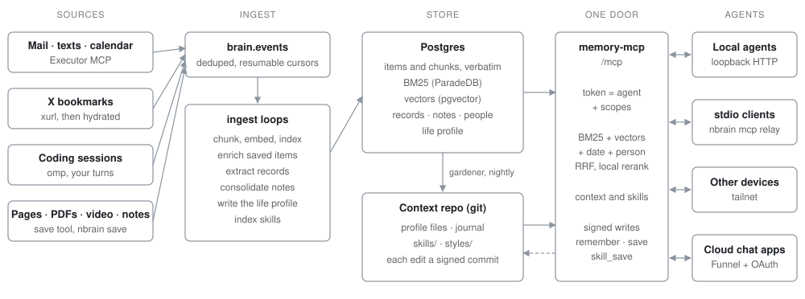

# nbrain

A personal second brain that every agent shares. nbrain keeps your mail, texts, calendar, X bookmarks, coding sessions and saved pages verbatim in Postgres. It keeps a short profile of you current in a git repo, and stores the skills and styles agents distill from work you approved. Agents reach all of it through one MCP server, each under its own token and scopes. A coding agent in the terminal and a chat app on your phone start from the same context, and what one learns the next one can use. It runs on your machine, and only model calls leave it.



## What it holds

| Source (`source`) | How it arrives | Token scope that reads it |
|---|---|---|
| Mail (`gmail`) | Gmail through an Executor MCP server, every minute | life |
| Texts (`imessage`) | Apple Messages through Executor, every minute | life |
| Calendar (`calendar`) | Apple Calendar through Executor, every 5 minutes, 7 days back to 30 ahead | life |
| X bookmarks (`x`) | `xurl` at 06:45 and 17:45, each post hydrated with its thread, quotes, article, linked pages and image descriptions | work |
| Coding sessions (`omp`) | Your words and the answer that closed each turn of top-level omp sessions, every 5 minutes | work |
| Saved (`saved`) | The `save` tool or `nbrain save`: pages, PDFs, YouTube, X posts, text, local files | work |
| Skills and styles (`skill`) | `skill_save`, as Agent Skills directories in the context repo | work |
| Notes (`memory`, `note`) | Consolidated from conversations every 5 minutes, latest wins; `remember` adds one at once | life |
| Records (`record`) | Bills, payments, orders and appointments read out of mail, texts and calendar, for SQL | life; SQL needs archive |
| Profile files | The context repo: basics, work style, principles, goals, tastes, projects, outputs, journal | work halves to work, `## Life` halves to life |
| Life profile | About 5 KB written from the current notes | life |

Connectors run only when named in `CONNECTORS`. With none, the brain starts with captures, skills and notes.

## How agents use it

| Tool | Scope | What it does |
|---|---|---|
| `context_get` | work, life | Start here: the profile cut to the token's scopes, the last 7 days of journal, the skills that fit the topic, and search hits for it |
| `memory_search` | work, life | Hybrid search with filters for person, source and dates; work tokens see work sources only |
| `memory_read` | work, life, archive | One item in 8 KB pages, with the neighbouring messages of its thread |
| `memory_query` | archive | One read-only `SELECT` over schema `memory` (records, items, people), 100 rows |
| `memory_person` | life | Who someone is: relationship, other names, handles, records, last threads |
| `memory_profile` | life | The current life profile |
| `remember` | write | Add one note, signed with the token's agent; append-only |
| `save` | write | Keep a URL, text or local file (local callers only); searchable in about a minute |
| `skill_get` | work, life | The catalog, or one skill or style with a manifest of its files |
| `skill_save` | write | Add or update a skill or style; an update must name the digest of the version it read |

The server also offers `context://` resources, every skill file as a `skill://` resource, the MCP Skills extension (`skills/list`, `skills/get`), and a prompt that loads the context into a chat. Its instructions tell each agent to call `context_get` first.

Search runs four channels over the chunks: BM25 (ParadeDB), vectors (Qwen3-Embedding-0.6B through Ollama), dates named in the query, and people named in the query. Reciprocal rank fusion merges them, one hit per item, and a local cross-encoder (Qwen3-Reranker-0.6B under llama-server) reorders the top 30. Without `RERANK_URL` it skips the rerank.

## Skills and styles

A skill says how you want a kind of work done; a style says how your things should look. Both are [Agent Skills](https://agentskills.io/specification) directories (`SKILL.md` plus `examples/`, `references/`, `assets/`) in the context repo, under `skills/<name>/` and `styles/<name>/`.

- **Authored** after you approve finished work. The agent loads the built-in guide (`nbrain/write-skill` or `nbrain/write-style`), distills from that session (your corrections quoted, each rule with its reason and value) and calls `skill_save`. Each save is a git commit signed with the agent's name. An update must pass the digest of the `SKILL.md` it read, so writers merge instead of rewriting from memory.
- **Found** without being asked for: each skill is indexed for search within a minute, `context_get` lists the three that best fit the topic plus your defaults, and the server instructions carry the catalog.
- **Loaded** 1-3 per task. In SkillsBench, one skill added 18.0 points and two or three added 19.0, but four or more added only 10.1. Compact skills beat comprehensive ones, and skills an agent wrote for itself before the task scored below none. Sources and the other design decisions: [docs/research.md](docs/research.md#skills-and-styles).

A style becomes the default only when you say so. From a shell: `nbrain skill list`, `nbrain skill show <name>`, `nbrain skill check <dir>`.

## Capture

Any agent with write scope can call `save`; from a shell, `nbrain save <url> --why "…"`, or `nbrain save -` to save text from stdin. Each kind of input has its own reader: X posts are hydrated, YouTube goes through `yt-dlp` transcripts, PDFs through unpdf (a scan with no text layer is refused), and pages through Defuddle. URLs are canonicalised, so saving the same thing twice answers `already`. The fetched page or PDF (up to 25 MB) is kept under `$BRAIN_HOME/captures`, because pages disappear. Within minutes one model call adds a summary, up to five tags and a context sentence for every chunk, and that sentence is indexed with the chunk ([contextual retrieval](docs/research.md#capture-and-retrieval-of-saved-things)). `nbrain search <query> [--source saved]` searches from a shell.

## Upkeep

| Loop | Every | What it does |
|---|---|---|
| `memory_events` | 1 min | Events to items and chunks, with embeddings |
| `memory_records` | 1 min | Records out of new mail, texts and calendar events |
| `capture_enrich` | 1 min | Summary, tags and chunk context for saved items |
| `memory_skills` | 1 min | Skills and styles into search |
| `memory_notes` | 5 min | Notes from new conversation turns, then the life profile if they changed |
| `garden` | 03:30 | Yesterday's journal and small edits to the profile files |

- **Notes.** A notes model reads new conversation turns and writes facts, preferences, rules, decisions and situations. Latest wins: a note that changes another replaces it, and only current notes are searchable. `remember` notes sit beside them, append-only.
- **Gardener.** Once a night it writes `journal/YYYY-MM-DD.md` and proposes a few line edits to each profile file, each citing its evidence. The default is no change, and every changed file is its own commit by `gardener`, so `git log -p` in the context repo is the audit trail and `git revert` undoes an edit. Preview a day with `nbrain garden --day YYYY-MM-DD --dry-run`.
- **Eval.** `nbrain eval questions.json` runs each question through the same search `memory_search` uses (all sources, reranked, 10 hits). A question passes only if every expected fact appears in the hits, so there is no LLM judge. Each miss names the stage that lost it. Results land in `$BRAIN_HOME/eval/recall-<time>.json`.

  ```json
  { "questions": [{ "id": "saved-1", "category": "saved", "query": "how much did context per chunk cut retrieval failures", "facts": ["49%"] }] }
  ```

- **Connectors** keep their position in `brain.cursors`, so a restart or an outage resumes where it stopped. `nbrain doctor` shows each connector's last success.

## Quickstart

Needs macOS, Docker, Node 26, [Ollama](https://ollama.com) and an OpenAI-compatible chat endpoint for the model calls. Optional: `llama-server` from llama.cpp for the reranker, `yt-dlp` for YouTube, `xurl` for X, a rendering page reader for JavaScript-heavy pages (`TF_PY`), and an Executor MCP server for mail, texts and calendar.

From a checkout:

```sh
npm install
docker compose up -d                  # Postgres 17 with pgvector and pg_search on 127.0.0.1:5433
ollama pull qwen3-embedding:0.6b
bin/nbrain init --name "Alex Rivera"  # writes ~/.brain/env, then stops
```

Edit `~/.brain/env`: check `OWNER_*`, `TZ` and `DATABASE_URL`, set `LLM_URLS` and `LLM_API_KEY` (or `LLM_API_KEY_FILE`), and uncomment `RERANK_URL` if you run `bin/run-rerank.sh`. Then:

```sh
bin/nbrain init                       # context repo, schema, roles memory_ro and memory_writer
bin/run-memory-mcp.sh                 # in its own shell: memory-mcp on 127.0.0.1:8830
bin/run-ingest.sh                     # in its own shell: connectors and upkeep loops
bin/nbrain doctor                     # every line should read ok
bin/nbrain connect claude-code        # or omp, codex, cursor, claude-desktop, json
```

Put `bin/` on your `PATH` to type `nbrain`; `nbrain help` lists every command (`init`, `doctor`, `connect`, `token`, `mcp`, `save`, `search`, `skill`, `garden`, `omp`, `eval`). `BRAIN_HOME` (default `~/.brain`) holds the env file, data, logs and the context repo; set it in your shell to keep a brain elsewhere. If port 5433 is taken, run `PG_PORT=5444 docker compose up -d` and change `DATABASE_URL` to match.

To keep it running on macOS, `bin/install-launchd.sh` renders the jobs in `launchd/` (memory-mcp, ingest, rerank, backup) into `~/Library/LaunchAgents`; leave out the ones you don't run with `SKIP="rerank backup"`. It never loads them; load each one:

```sh
SKIP="rerank backup" bin/install-launchd.sh
launchctl bootstrap gui/$(id -u) ~/Library/LaunchAgents/dev.brain.memory-mcp.plist
launchctl bootstrap gui/$(id -u) ~/Library/LaunchAgents/dev.brain.ingest.plist
```

Restart memory-mcp without dropping a request with `bin/restart-memory-mcp.sh`. Backups (`bin/backup.sh`) go to any restic repository set in `RESTIC_REPOSITORY`.

**Linux.** The launchd templates, `KEYCHAIN_PREFIX` and the Claude Desktop config path are macOS-only. Run `bin/run-memory-mcp.sh`, `bin/run-ingest.sh` and, if you use it, `bin/run-rerank.sh` under systemd or a shell.

### A first run

On an empty database, a Codex CLI agent connected through the stdio relay called `context_get`, loaded the built-in `write-skill` guide and saved [an article on contextual retrieval](https://www.anthropic.com/news/contextual-retrieval). Within a minute the article had a summary, five tags and context on all 14 chunks. The agent then wrote a skill, `research-writeup`, from a document that had been approved. A second, fresh Codex agent asked for a research write-up loaded `research-writeup` first without being told to, followed it, and cited the saved article.

## Connecting clients

`nbrain connect <client>` mints a token for the client (its name is the agent every write is signed with) and writes the server into the client's config.

| Client | Command | Transport |
|---|---|---|
| omp | `nbrain connect omp` | HTTP |
| Claude Code | `nbrain connect claude-code` | HTTP |
| Cursor | `nbrain connect cursor` | HTTP |
| Codex | `nbrain connect codex` | stdio relay |
| Claude Desktop | `nbrain connect claude-desktop` | stdio relay |
| Any MCP client | `nbrain connect json` | prints both forms |

Flags: `--agent <name>`, `--scopes work,life,archive,write` (default `work,write`), `--remote` (use `PUBLIC_URL` instead of loopback). Configs, scopes, remote access over Tailscale or Cloudflare Tunnel, OAuth for cloud chat apps, and plain HTTP with curl: [docs/connect.md](docs/connect.md).

## Privacy model

- **Local first.** Postgres, the context repo, embeddings and reranking run on your machine. memory-mcp listens on 127.0.0.1 only; anything remote comes in through a proxy you set up.
- **What leaves.** Brain content leaves the machine only in model calls to `LLM_URLS` (records, notes, enrichment, image descriptions, the gardener). Other outbound requests fetch what you asked to keep: a saved URL, X bookmarks and their links, YouTube transcripts.
- **Scopes.** Every caller is a token: an agent name plus scopes. `work` sees the work halves of the profile and the work sources (X, saved, skills, coding sessions). `life` adds mail, texts, calendar, notes, people and the life profile. `archive` adds SQL over everything. `write` allows `remember`, `save` and `skill_save`.
- **Signed writes.** A write carries the token's agent name, never a name the caller gives: notes record it, and skill saves are git commits authored by it.
- **Tokens hashed.** `$BRAIN_HOME/memory-mcp/tokens.json` stores only the SHA-256 of each token; `nbrain token list` and `nbrain token revoke <agent|grant-id>` manage them.
- **Least privilege in Postgres.** memory-mcp never gets the superuser URL. It reads as `memory_ro`, which can only `SELECT` schema `memory`, and writes as `memory_writer`, which can only insert. Their passwords live in the env file or, with `KEYCHAIN_PREFIX`, the macOS Keychain.
- **Logs and a kill switch.** Each call is logged with clipped arguments and never its result; writes log metadata only. `touch $BRAIN_HOME/memory-mcp/DISABLED` makes `/mcp` answer 503.

## Configuration

Every setting lives in `$BRAIN_HOME/env`; [env.example](env.example) documents each one: who the brain is about, Postgres, the memory-mcp port and public door, local models, chat models and per-role model overrides, connectors, and backups. `bin/nbrain` and every `bin/run-*.sh` script load it.

## Development

```sh
npm install
npx tsc --noEmit -p tsconfig.json   # npm run check
npx vitest run                      # npm test
```

Tests run as a made-up owner in a fixed time zone. Point them at a throwaway `BRAIN_HOME` and database, never a live brain. Tool names, inputs and scopes are a public contract (`src/mcp/contract.ts` and the tool table in `src/mcp/server.ts`): add tools freely, but renaming one or changing its inputs breaks connected clients. The research behind the design is in [docs/research.md](docs/research.md).

## License

MIT. See [LICENSE](LICENSE).
